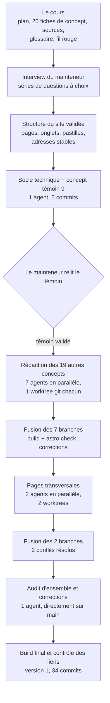
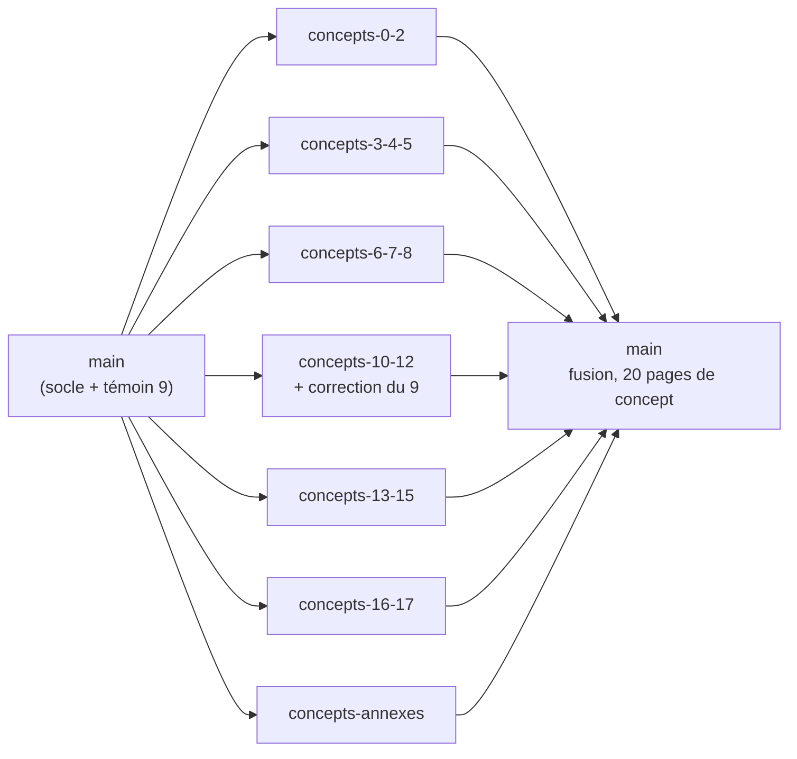
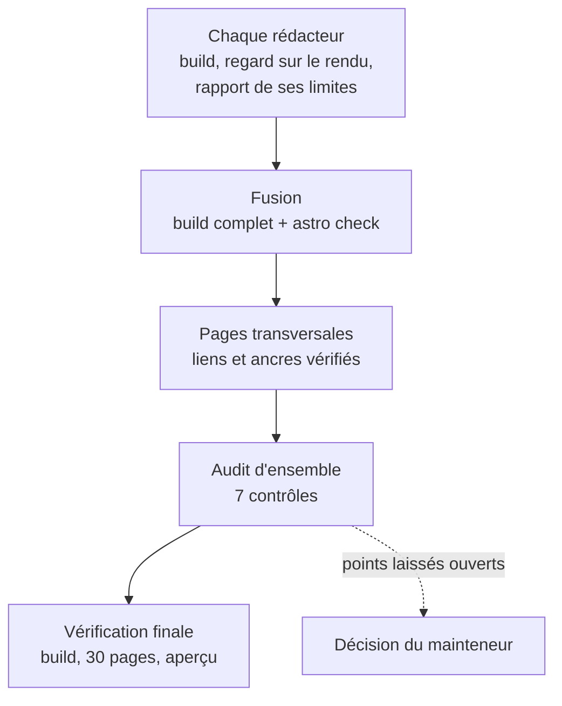

# Comment ce site a été construit

Ce document décrit la fabrication de la première version du site : l'enchaînement des étapes, les agents qui ont écrit les pages, les contrôles qui ont garanti la qualité, et ce qui n'a pas été vérifié. Il se suffit à lui-même.

La première version a été produite le 24 octobre 2026, en une journée, par un agent principal (un assistant d'IA, Claude Code) qui a lancé des sous-agents en parallèle. Le mainteneur du cours a décidé de la structure et des principes, relu une page témoin, puis laissé les agents dérouler le reste. Il n'a relu ni les autres pages ni les audits avant la rédaction de ce document.

## Le flux d'ensemble

Deux décisions ont structuré ce flux :

- **Un témoin d'abord.** Avant de déléguer 19 pages, une page complète (le concept 9) a été écrite et relue par le mainteneur. Les sept rédacteurs ont reçu cette page comme modèle : même forme, même niveau de détail.
- **Isolation par worktree.** Chaque rédacteur a travaillé dans son propre worktree git (un dossier de travail distinct sur une branche distincte). Chacun ne touchait que ses fichiers, donc les fusions ont eu lieu sans conflit.

## Les étapes

### 1. Structure et interview

Le mainteneur a répondu à cinq séries de questions à choix (public, fonctions, style, techno, licence), puis à une sixième par messages (nom du site, neuf parcours de lecture). Les décisions retenues : une vitrine publique ; le contenu du cours mis en forme pour le web, sans question ni exercice ; un site avec son propre contenu, qui évolue ensuite en complément du cours ; une page par concept à trois onglets (Comprendre, Consensus ou école, Sources) ; trois pastilles pour dire d'où vient une affirmation (consensus, choix d'école, choix du cours) ; des adresses stables pour pouvoir y renvoyer ; Astro et Pagefind ; licence CC BY ; neuf parcours de lecture par situation. La structure a été écrite avant toute ligne de code.

### 2. Socle et concept témoin

Un premier agent a construit le squelette Astro, les pages minimales (accueil, parcours, à propos, recherche, 404), la page du concept 9 avec deux schémas SVG dessinés à la main, la licence et le workflow de déploiement (déclenchement manuel seulement). Il a contrôlé l'affichage au bureau et à 375 px de large, en clair et en sombre, la navigation au clavier dans les onglets, et la recherche avec un préfixe d'adresse de projet.

### 3. Rédaction parallèle des concepts

Sept agents ont rédigé les 19 autres concepts et leurs schémas, par groupes : 0 à 2, 3 à 5, 6 à 8, 10 à 12, 13 à 15, 16 et 17, annexes A1 et A2. Le groupe 10 à 12 a aussi corrigé le concept 9 (voir plus bas).

### 4. Pages transversales

Deux agents, en parallèle, chacun dans son worktree :

- **transversal-1** : glossaire (avec les termes à éviter), page Fil rouge, parcours de lecture, menu.
- **transversal-2** : index « Consensus ou école » et index des sources, générés depuis les concepts plutôt que recopiés ; objectifs du cours en en-tête de concept et filtre du parcours.

La fusion des deux branches a produit deux conflits (le `README.md` et la navigation de la mise en page), résolus en gardant les deux jeux d'entrées.

### 5. Audit d'ensemble

Un dernier agent a audité tout le site et corrigé directement sur `main` ce qui était mécanique, en listant le reste pour le mainteneur. Il a produit 11 commits.

## Les agents

Onze agents au total, tous lancés en arrière-plan. À eux tous : environ 2,5 millions de jetons et 664 appels d'outils (somme des comptes rendus de fin de chaque agent).

| Agent | Rôle | Reçoit | Produit | Où il travaille |
|---|---|---|---|---|
| Socle et témoin | Squelette technique et page du concept 9 | La structure validée, le plan, le fil rouge, le glossaire, la fiche et les sources du concept 9 | Le projet Astro, les pages minimales, le concept 9, deux schémas, la licence, le workflow de déploiement | Le dépôt neuf, sur `main` |
| Rédaction 0 à 2 | Rédiger trois concepts | La consigne commune (ci-dessous) | 3 pages, 3 schémas | Worktree et branche `concepts-0-2` |
| Rédaction 3 à 5 | idem | idem | 3 pages, 3 schémas | `concepts-3-4-5` |
| Rédaction 6 à 8 | idem | idem | 3 pages, 3 schémas | `concepts-6-7-8` |
| Rédaction 10 à 12 | Rédiger trois concepts et corriger le témoin | La consigne commune, plus la correction du 9b | 3 pages, 3 schémas, concept 9 corrigé | `concepts-10-12` |
| Rédaction 13 à 15 | Rédiger trois concepts | La consigne commune | 3 pages, 3 schémas | `concepts-13-15` |
| Rédaction 16 et 17 | Rédiger deux concepts | La consigne commune | 2 pages, 3 schémas | `concepts-16-17` |
| Rédaction des annexes | Rédiger A1 et A2 | La consigne commune | 2 pages, 2 schémas | `concepts-annexes` |
| Transversal 1 | Glossaire, fil rouge, parcours de lecture | Le site et le cours | Les trois pages, le menu replié, les données associées | `transversal-1` |
| Transversal 2 | Index des écoles et des sources, objectifs | Le site et le cours | Les deux index, le filtre par objectif | `transversal-2` |
| Audit | Contrôler tout le site, corriger le mécanique | Sept contrôles (voir plus bas) | 11 commits, une liste de points laissés au mainteneur | `main` |

**La consigne commune aux sept rédacteurs.** Lire d'abord la page témoin approuvée, puis la fiche du concept et ses sources, en lecture seule. Rédiger une page pour un lecteur autonome, à trois onglets. Aucune question, aucune réponse attendue, aucun exercice, et ne pas dévoiler la réponse d'un exercice. « Le test rapide » devient « Le réflexe » ; « Pièges » devient « Les erreurs classiques ». Garder les attributions et les réserves des sources, sans rien durcir. Dessiner un schéma SVG statique par concept. Ne toucher qu'à ses propres fichiers. Créer son worktree et sa branche, installer, construire, regarder les pages au bureau et à 375 px, en clair et en sombre. Rendre un rapport de 15 lignes au plus.

## La méthode de qualité

Aucun mécanisme unique ne garantit la qualité : ce sont des contrôles empilés, chacun attrapant des défauts que les autres laissent passer.

1. **Le témoin relu avant le déroulement.** Seule relecture humaine du contenu : elle a fixé la forme et a révélé un défaut (le 9b dévoilait la réponse d'un exercice), corrigé ensuite.
2. **Les rapports de limites.** Chaque agent dit ce qu'il n'a pas regardé (onglets non ouverts, schémas non vus en sombre, etc.). Ces rapports alimentent la section « Ce qui n'a pas été vérifié ».
3. **Le build à chaque fusion.** `astro build` et `astro check` après la fusion des sept branches ont trouvé une erreur de type et une variable inutilisée, corrigées.
4. **L'audit d'ensemble**, sept contrôles :
   - fuites de réponses d'exercice : chaque page comparée aux exercices de sa fiche, avec un recoupement automatique de phrases de neuf mots et plus ;
   - fidélité aux sources : 20 concepts relus, dont 12 en profondeur ;
   - rien de propre à un apprenant ou à un agent ;
   - style : pas de tiret long ni de flèche en prose, pas de marqueur d'exercice ;
   - cohérence : composants, classes CSS en collision, script de contrôle des liens sur le site construit ;
   - accessibilité et mobile ;
   - build.

### Ce que les contrôles ont produit

| Contrôle | Résultat |
|---|---|
| Fuites d'exercice | environ 40 passages retirés ou généralisés, sur 20 concepts ; les plus nettes dans les schémas 02, A1 et A2, le découpage du 9b et la réponse du 14 |
| Fidélité | environ 25 corrections : attributions rectifiées, une dizaine de pastilles « choix du cours » ajoutées, formulations durcies adoucies, affirmations sans source retirées |
| Typographie | environ 700 apostrophes droites supprimées par un traitement centralisé (`src/middleware.ts`) ; une quinzaine de « concept A1 » remplacés par « annexe A1 » |
| Schémas | 26 figures vues en clair, 9 en sombre, 2 à 375 px ; deux débordements de texte corrigés |
| Contraste | 6 758 éléments de texte testés, aucun échec |
| Liens et ancres | script sur le site construit : 0 lien cassé sur 30 pages |
| Mobile | aucun défilement horizontal à 375 px sur les 30 pages |

### Les erreurs de parcours

- **Collisions de classes CSS.** Les schémas définissaient des classes (`.card`, `.box`, `.panel`, `.q`, `.tag`, `.note`) qui entraient en collision avec les styles globaux. Correction : préfixe propre à chaque schéma, sans toucher au CSS global.
- **Fuites d'exercice.** Détectées d'abord sur le témoin, puis généralisées par les rédacteurs, puis nettoyées par l'audit (environ 40 passages).
- **Sources d'origine interne.** Des références qui provenaient de notes internes du cours, et non de sources publiques, ont été retirées des onglets Sources, ce qui laisse des trous dans la numérotation de certaines références.
- **Conflits de fusion.** Le `README.md` et la navigation, lors de la fusion des deux branches transversales.
- **Détails.** Une erreur de type et une variable inutilisée dans deux schémas ; un `sed -i` incompatible avec macOS ; des worktrees qui ne se supprimaient pas ; un avertissement TypeScript du filtre du glossaire, qui a demandé trois commits.

## Le site obtenu

| | |
|---|---|
| Pages de concept | 20 (18 concepts, 2 annexes) |
| Pages indexées par la recherche (Pagefind) | 28 |
| Pages HTML construites | 30 |
| Termes de glossaire | 90 |
| Positions « consensus ou école » | 199 (45 consensus, 62 choix d'école, 92 choix du cours) |
| Documents de sources, dédoublonnés | 141 |
| Commits sur `main` | 34, dont 7 fusions |

## Ce qui n'a pas été vérifié

- **Relecture humaine.** Le mainteneur n'a relu que le concept témoin. Le contenu des 19 autres pages a été relu par son rédacteur, puis échantillonné par l'audit.
- **Environnements.** Le rendu sans JavaScript, Safari, Firefox, un vrai téléphone, un lecteur d'écran, et le déploiement par GitHub Actions n'ont pas été testés. Le focus clavier visible et les schémas en sombre à 375 px ont été contrôlés dans le CSS, pas à l'écran.
- **Sources.** Les adresses et les citations des sources externes ont été comparées aux fiches du cours, pas au web. Les points « Non vérifié » des fiches de sources sont repris tels quels sur le site.
- **Fuites d'exercice.** Le recoupement automatique porte sur des phrases de neuf mots et plus : une paraphrase peut lui échapper.
- **Onglets.** Pour plusieurs concepts, les onglets Consensus ou école et Sources n'ont pas été ouverts par le rédacteur ; seul un script a vérifié que les références citées sont définies.
- **Affirmations douteuses signalées par les rédacteurs.** Un rattachement de position à « choix du cours » sans source ; une affirmation sur SAFe qui repose sur une source de marketing ; les « cinq pourquoi » attribués seulement à Toyota ; une ligne sur les « 10 % de capacité » du Scrum Guide 2017 non revérifiée.
- **Points laissés ouverts par l'audit.** Des passages gardés en principes généraux à trancher ; le regroupement des auteurs dans l'index des écoles (deux groupes pour Lawrence, le Scrum Guide en trois) ; une formule du fil rouge qui reprend un terme que le glossaire déconseille ; du code mort lié aux pages « bientôt » ; une incohérence dans l'annexe A1 ; la licence du code, non décidée à cette date.

## Les chiffres : d'où ils viennent

Les décomptes de pages, de termes, de positions, de documents et de commits ont été recomptés sur le site construit le jour de la rédaction de ce document. Les chiffres de l'audit (passages de fuites, corrections de fidélité, apostrophes, figures, éléments testés au contraste) sont ceux du rapport de l'agent d'audit. Les totaux de jetons et d'appels sont la somme des comptes rendus de fin des onze agents.
