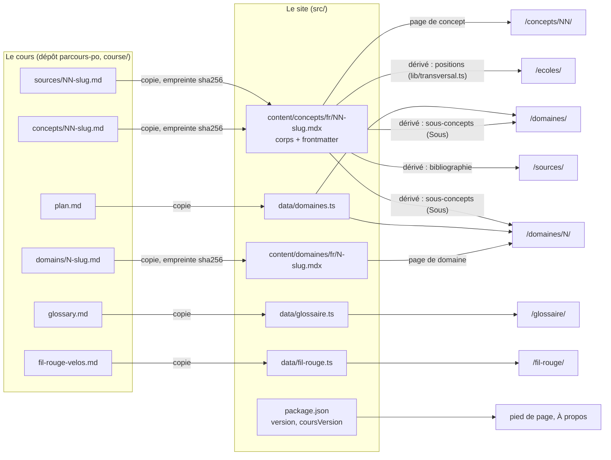

# Carte des données

D'où vient chaque information affichée par le site. Trois origines :

- **copie** : recopiée à la main depuis le cours (`course/` du dépôt `parcours-po`), récrite pour un
  lecteur autonome ; à réaligner quand le cours change ;
- **dérivée** : calculée au build depuis une autre donnée du site, rien à recopier ;
- **site** : propre au site (forme, interface, textes d'orientation).

## Page par page

| Ce qui s'affiche | Fichier du site | Origine |
|---|---|---|
| Concept : titre, objectif, prérequis, description | frontmatter de `src/content/concepts/fr/NN-slug.mdx` | copie de `course/concepts/NN-slug.md` |
| Concept : onglet Comprendre (texte, sous-concepts, réflexe, erreurs classiques) | corps MDX de la même page | copie de la fiche du concept (sections L'essentiel, Sous-concepts, Le test rapide, Pièges ; la banque d'exemples n'est pas reprise, seules ses « Explication » servent) |
| Concept : onglet Consensus ou école | frontmatter `ecoles` | copie de la fiche du concept (Consensus et choix d'école) |
| Concept : onglet Sources | frontmatter `sources` | copie de `course/sources/NN-slug.md` |
| Concept : schémas | `src/components/schemas/` | site (forme) ; ils ne contredisent pas la fiche |
| Concept et domaine : domaine, précédent et suivant | `src/data/domaines.ts`, ordre de lecture dans `src/lib/lecture.ts` | copie de `course/plan.md` |
| Empreintes et version du cours d'une page | frontmatter `alignement` | dérivée : écrite par `npm run check-alignment -- --stamp NN` |
| Page de domaine : présentation | corps MDX de `src/content/domaines/fr/N-slug.mdx` | copie de `course/domains/N-slug.md` (renvois « concept N » en `<Renvoi>`) |
| Domaines et page de domaine : titres, « à la fin, vous savez », concepts | `src/data/domaines.ts` | copie de `course/plan.md` (Domaines du cours, Concepts, Annexes) |
| Page de domaine et annexes : sous-concepts et promesses | attributs des `<Sous>` des pages | dérivée au build (`sousConcepts`, `src/lib/concepts.ts`) |
| Consensus ou école (index) | `src/lib/transversal.ts` | dérivée au build des frontmatters `ecoles` |
| Sources (page) | `src/lib/transversal.ts` | dérivée au build des frontmatters `sources` |
| Glossaire | `src/data/glossaire.ts` | copie de `course/glossary.md` |
| Fil rouge | `src/data/fil-rouge.ts` | copie de `course/fil-rouge-velos.md` |
| Version du site et du cours | `package.json` (`version`, `parcoursPo.coursVersion`) via `src/data/version.ts` | site |
| Libellés de l'interface (menu, onglets, pastilles) | `src/i18n/ui.ts` | site |
| Icônes et marque du site | `src/icons/` ; favicon : `public/favicon.svg`, même dessin | site |
| Accueil, À propos, chapeaux des pages | `src/pages/*.astro` | site (texte public : relu par le mainteneur) |
| Recherche | `dist/pagefind/` | dérivée au build (Pagefind indexe les pages qui portent `data-pagefind-body`) |
| Typographie (espaces insécables, apostrophes) | `src/lib/typo-fr.ts`, `src/middleware.ts` | dérivée au rendu |

## Ce qui est contrôlé

- Les pages de concept portent les empreintes de leurs deux fiches, les pages de domaine celle de
  leur fiche `course/domains` : `npm run check-alignment` liste celles dont une fiche a changé
  (avertissement dans `npm run verify`).
- `domaines.ts`, `glossaire.ts` et `fil-rouge.ts` n'ont pas d'empreinte : rien ne signale un écart
  avec `plan.md`, `glossary.md` ou `fil-rouge-velos.md`. À relire quand le cours publie une version.
- Le titre d'un concept vit à deux endroits : `titre` du frontmatter (en-tête de la page) et
  `domaines.ts` (Domaines, précédent et suivant, prérequis). Les deux changent ensemble.
